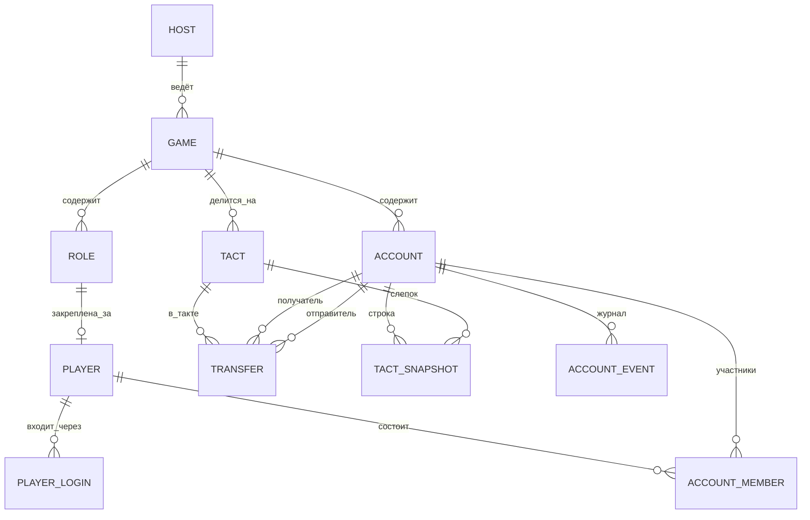

# Игровой банк — архитектура, экраны, модель данных

Статус: **проект на согласование**. Код не пишется, пока не закрыты вопросы из раздела 6.

Банк оперирует только виртуальными игровыми деньгами. Нет реальных платежей, карт, кредитов, процентов, KYC.

---

## 1. Минимальная архитектура

```
                    ┌──────────────────────────────────────────────┐
  Браузер (телефон/ │  Web SPA (React + Vite)                      │
  ПК) — игрок       │   /play/*   — кабинет игрока                 │
                    │   /admin/*  — кабинет ведущего / канцелярии  │
  Telegram Mini App │  Тот же SPA, открытый через WebApp-кнопку    │
                    └───────────────┬──────────────────────────────┘
                                    │ REST + WebSocket (живые балансы)
  Telegram-бот ───── grammY ───┐    │
                               ▼    ▼
                    ┌──────────────────────────────────────────────┐
                    │  Backend: Node.js + TypeScript (Fastify)     │
                    │   • доменный сервис «Переводы» (одна точка   │
                    │     списания для всех интерфейсов)           │
                    │   • бот работает в том же процессе           │
                    │   • очередь синхронизации в Google Sheets    │
                    └───────┬──────────────────────────┬───────────┘
                            ▼                          ▼
                    PostgreSQL (единая база)    Google Sheets API
                                                (service account)
```

Почему так:

- **Один backend и одна БД** — веб, бот и Mini App вызывают один и тот же сервис переводов, поэтому балансы синхронизированы по определению.
- **Mini App = тот же веб-клиент.** Отличается только вход: подпись `initData` от Telegram вместо кода роли на каждом устройстве.
- **Бот** — тонкий интерфейс: баланс, история, перевод через диалог, кнопка «Открыть банк» (Mini App).
- **PostgreSQL**: перевод — одна транзакция с блокировкой строк счетов (`SELECT … FOR UPDATE`), проверкой баланса и уникальным `idempotency_key`. Это закрывает требования «нельзя уйти в минус» и «нет двойного списания».
- **Суммы** — целые числа (`bigint`), без копеек и без float.
- **Деплой**: один Docker-контейнер + Postgres (VPS, Railway, Render — уточнить).

### Google Sheets / Excel

- Ведущий подключает Google-таблицу к игре (даёт доступ сервисному аккаунту на редактирование).
- После каждого перевода backend дописывает строку в лист «Переводы». Лист «Сводка» пересчитывается с задержкой ~2–5 с (пакетно, чтобы не упереться в лимиты API).
- Таблица встраивается в кабинет ведущего через `<iframe>` (нужен доступ «по ссылке» или вход в Google в том же браузере). Данные обновляются почти в реальном времени.
- **Макросы не нужны**: заполняет backend через API. Это надёжнее Apps Script и работает без открытой таблицы.
- Excel: кнопка «Скачать .xlsx» (переводы + сводка с текущими фильтрами). Google-таблицу тоже можно скачать в xlsx.
- Источник правды — БД. Ручные правки в таблице на балансы не влияют.

---

## 2. Роли и доступ

| Кто | Как входит | Что может |
|---|---|---|
| Ведущий / канцелярия | email/логин + пароль (веб) | всё в своих играх |
| Игрок | первый раз: игра → ведущий → роль → имя, фамилия → код роли (4 цифры). Дальше — сессия на устройстве; в Telegram — по `telegram_id` | свои счета, переводы, создание юрлиц/счёта физлица |
| Совладелец счёта | вводит PIN счёта (4 цифры) | см. вопрос 6.2 |

Код роли выдаёт ведущий. После успешного ввода роль закрепляется за игроком, и второй раз её занять нельзя (ведущий может сбросить привязку).

---

## 3. Модель данных



| Таблица | Поля (основные) | Примечания |
|---|---|---|
| `host` | id, name, login, password_hash | ведущий / сотрудник канцелярии |
| `game` | id, host_id, title, status (`draft` / `active` / `finished`), current_tact_id, sheet_id | |
| `role` | id, game_id, title, code_hash, description | код — 4 цифры, хранится хешем, показывается ведущему при генерации |
| `player` | id, game_id, role_id (unique), first_name, last_name, created_at | один игрок = одна роль в игре |
| `player_login` | id, player_id, kind (`web` / `telegram`), telegram_id, session_token_hash | веб-сессия и Telegram ведут к одному игроку |
| `account` | id, game_id, kind (`legal` — юрлицо, `individual` — счёт физлица), title, balance (bigint ≥ 0), pin_hash, created_by_player_id, created_at, is_initial | исходные юрлица создаёт ведущий |
| `account_member` | account_id, player_id, member_role (`owner` / `coowner`) | ровно один `owner` на счёт |
| `tact` | id, game_id, number, started_at, closed_at | открытый такт — тот, у которого `closed_at IS NULL` |
| `transfer` | id, game_id, tact_id, from_account_id, to_account_id, amount (>0), comment, initiator_player_id, idempotency_key (unique), created_at | необратимо; append-only |
| `tact_snapshot` | tact_id, account_id, balance_start, received, sent, balance_end, owners_text | фиксируется кнопкой «Завершить такт» |
| `account_event` | id, account_id, type (`created` / `member_added` / `member_removed` / `owner_changed` / `pin_changed`), actor_player_id, payload, created_at | журнал передачи юрлиц и смены состава |

Стартовые балансы: при запуске игры ведущим создаётся `transfer` из системного счёта «Канцелярия» (или напрямую выставляется `balance` — см. вопрос 6.7), чтобы сводка такта 1 сходилась.

Инварианты:
- `balance` меняется только внутри транзакции перевода.
- `from_account_id ≠ to_account_id`, оба счёта в одной игре.
- Сумма > 0, `amount ≤ balance` отправителя на момент блокировки.
- Повтор запроса с тем же `idempotency_key` возвращает уже созданный перевод, а не новый.

---

## 4. Основные экраны

### Игрок (веб / Mini App)

1. **Вход** — список активных игр (название + ведущий) → роль (только свободные) → имя, фамилия → код роли.
2. **Мои счета** — список: юрлица и счёт физлица, у каждого название, тип, баланс. Кнопки «Перевести», «Завести новое юрлицо».
3. **Счёт** — баланс, участники (владелец, совладельцы), история операций: дата, такт, контрагент, ±сумма, комментарий, кто инициировал.
4. **Перевод** — счёт отправителя (из своих) → получатель (поиск по названию среди счетов игры) → сумма → комментарий → экран подтверждения «Перевести 500 с «ООО Ромашка» на «Банк Севера»?» → результат. Кнопка блокируется после нажатия, запрос несёт `idempotency_key`.
5. **Новое юрлицо / счёт физлица** — название, совладельцы (выбор из игроков игры), PIN из 4 цифр + повтор.
6. **Настройки** — подключить счёт по PIN (для совладельцев), передать юрлицо другому игроку, сменить PIN (только владелец — к согласованию), выход.

### Telegram-бот

- `/start` — привязка к игроку (код роли) или кнопка «Открыть банк» (Mini App).
- `/balance` — счета и балансы.
- `/history` — последние операции по выбранному счёту.
- `/send` — перевод пошагово: счёт → получатель → сумма → комментарий → «Подтвердить / Отмена».
- Уведомления о входящих переводах (уточнить — вопрос 6.10).

### Ведущий / канцелярия (веб, `/admin`)

1. **Игры** — список, «Создать игру».
2. **Настройка игры** — роли (название, сгенерировать/показать код), исходные юрлица (название, владелец-роль, совладельцы, стартовый баланс), подключение Google-таблицы, кнопка «Запустить игру».
3. **Участники** — дерево «игрок → роль → счета (владелец / совладелец)», сброс привязки роли.
4. **Переводы** — таблица: дата и время, такт, инициатор, отправитель, получатель, сумма, комментарий. Фильтры: такт, игрок, юрлицо. Экспорт xlsx.
5. **Сводка по счетам** — владелец и совладельцы, баланс на начало такта, получено, отправлено, баланс на конец. Фильтры те же.
6. **Такты** — текущий такт, кнопка «Завершить такт» (с подтверждением) → слепок; архив слепков: сколько денег у каждого счёта и у каждого игрока в сумме.
7. **Google-таблица** — встроенный iframe, статус последней синхронизации.

---

## 5. Что сознательно не делаем

Реальные платежи, карты, кредиты, проценты, вклады, валюты, отмена/возврат переводов, чат, KYC, мультиязычность. Всё перечисленное — только по отдельному решению.

---

## 6. Вопросы до реализации

Рядом с каждым вопросом — предложение по умолчанию. Ответы фиксируются здесь же после согласования.

1. **Зачем PIN счёта, если роль уже подтверждена?** Предложение: PIN нужен только чтобы *подключить* счёт к своему кабинету (совладельцу, или себе в новом интерфейсе). Для каждого перевода PIN не спрашиваем.
2. **Права совладельцев.** Предложение: владелец и совладельцы одинаково видят счёт и переводят с него. Только владелец меняет состав совладельцев, PIN и передаёт юрлицо.
3. **Совладельцы при создании** — получают доступ сразу или только после ввода PIN? Предложение: указанные совладельцы видят счёт сразу. PIN — для тех, кого не указали, но кому владелец сообщил пароль (тогда они добавляются как совладельцы).
4. **Счёт физлица** — один на игрока или сколько угодно? Есть ли у роли «личный» счёт автоматически? Предложение: при подтверждении роли автоматически создаётся один счёт физлица с нулевым балансом (или стартовым, если задал ведущий); юрлиц — сколько угодно.
5. **Передача юрлица** — нужно ли согласие получателя? Остаётся ли бывший владелец совладельцем? Предложение: передача мгновенная, без согласия; бывший владелец теряет доступ, если новый владелец его не добавит.
6. **Получатель перевода** — только юрлица или и счета физлиц тоже? Предложение: любой счёт игры (юрлицо или физлицо).
7. **Права ведущего на деньги.** В ТЗ — только стартовые балансы. Нужны ли ведущему ручные начисления/списания по ходу игры (штрафы, доходы)? Предложение: нет; стартовые балансы оформляются переводами от системного счёта «Канцелярия», чтобы сводка сходилась.
8. **Такты.** «Завершить такт» сразу открывает следующий? Можно ли переводить, пока ведущий не открыл новый такт? Предложение: завершение такта сразу открывает следующий, переводы не останавливаются.
9. **Вход игрока на другом устройстве / в Telegram.** Предложение: повторный ввод кода роли привязывает новое устройство или Telegram к тому же игроку. Код можно ввести сколько угодно раз, но новую роль на него не занять.
10. **Уведомления в Telegram о входящих переводах** — нужны? Предложение: да, короткое сообщение «+500 на «ООО Ромашка» от «Банк Севера»».
11. **«Выбирает игру и ведущего»** — у одной игры может быть несколько ведущих / сотрудников канцелярии? Предложение: у игры один ведущий-владелец + он может добавить логины сотрудников канцелярии с теми же правами.
12. **Google Sheets.** Устраивает ли запись через API (без макросов) с задержкой 2–5 с, плюс выгрузка xlsx? Есть ли у вас Google Workspace / готовый сервисный аккаунт?
13. **Хостинг и бот.** Где разворачиваем (VPS / Railway / Render)? Есть ли токен бота от @BotFather?
