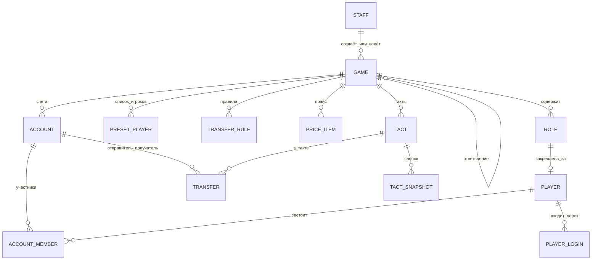

# Игровой банк — архитектура, экраны, модель данных

Статус: **проект на согласование (версия 2)**. Основные правила согласованы (раздел 6), остались уточнения из раздела 7.

Банк оперирует только виртуальными игровыми деньгами. Нет реальных платежей, карт, кредитов, процентов, KYC.

---

## 1. Минимальная архитектура

```
                    ┌──────────────────────────────────────────────┐
  Браузер (телефон/ │  Web SPA (React + Vite)                      │
  ПК) — игрок       │   /play/*   — кабинет игрока                 │
                    │   /admin/*  — кабинет ведущего (игротехника) │
                    │   /super/*  — кабинет Супер-ведущего         │
  Telegram Mini App │  Тот же SPA, открытый через WebApp-кнопку    │
                    └───────────────┬──────────────────────────────┘
                                    │ REST + WebSocket (живые балансы)
  Telegram-бот ───── grammY ───┐    │
                               ▼    ▼
                    ┌──────────────────────────────────────────────┐
                    │  Backend: Node.js + TypeScript (Fastify)     │
                    │   • доменный сервис «Переводы» (одна точка   │
                    │     списания для всех интерфейсов)           │
                    │   • бот работает в том же процессе           │
                    │   • очередь синхронизации в Google Sheets    │
                    └───────┬──────────────────────────┬───────────┘
                            ▼                          ▼
                    PostgreSQL (единая база)    Google Sheets API
                                                (подключим позже)
```

- **Один backend и одна БД** — веб, бот и Mini App вызывают один и тот же сервис переводов, поэтому балансы синхронизированы по определению.
- **Mini App = тот же веб-клиент.** Отличается только вход: подпись `initData` от Telegram.
- **Перевод** — одна транзакция с блокировкой счетов (`SELECT … FOR UPDATE`), проверкой баланса, проверкой правил игры и уникальным `idempotency_key`. Нельзя уйти в минус, нет двойного списания.
- **Суммы** — целые числа (`bigint`).
- **Деплой**: один Docker-контейнер + Postgres. Хостинг выберем позже.

### Порядок реализации

1. Backend + БД + веб: Супер-ведущий, ведущий, игрок, переводы, такты, таблицы, выгрузка xlsx.
2. Telegram-бот и Mini App.
3. Синхронизация с Google Sheets (встраивание в кабинет ведущего, запись через API без макросов).

---

## 2. Роли пользователей

| Кто | Как входит | Что может |
|---|---|---|
| **Супер-ведущий** | логин + пароль | создаёт и описывает игры-шаблоны: роли, стартовые балансы, правила переводов, прайс фиксированных платежей; делает ответвления (копии игры) и назначает на них ведущих; видит все игры |
| **Ведущий (игротехник)** | логин + пароль | ведёт своё ответвление игры: участники, ручные начисления и списания, приём платежей, такты, свои таблицы переводов и сводки; может добавить сотрудников канцелярии с теми же правами |
| **Игрок** | первый раз: игра → ведущий → роль → имя, фамилия → код роли (4 цифры). Новое устройство / Telegram — повторный ввод кода роли | свои счета, переводы, создание юрлиц, передача юрлица |
| **Совладелец счёта** | видит счёт сразу; для переводов с этого счёта один раз вводит PIN счёта | переводы со счёта |

---

## 3. Игры и ответвления

- **Игра-шаблон** (создаёт Супер-ведущий) — описание: роли, стартовые юрлица и счета, стартовые балансы, правила переводов, прайс, заранее заданный список игроков.
- **Ответвление** — копия игры со всеми настройками, к которой прикреплён ведущий (игротехник). Деньги, переводы, такты и таблицы у каждого ответвления свои. Коды ролей в каждом ответвлении генерируются заново.
- Игрок при входе выбирает «игру и ведущего» — по сути, ответвление.
- У каждого ответвления своя таблица переводов и сводка (в веб-кабинете, позже — своя Google-таблица).

### Правила переводов (настраиваются в игре)

Каждая операция имеет тип. Супер-ведущий включает/выключает типы для игры:

| Тип | Откуда → куда | Сумма |
|---|---|---|
| `player` | счёт игрока → счёт игрока (направления настраиваются, см. 7.1) | любая > 0 |
| `to_host` | счёт игрока → счёт ведущего | любая > 0 |
| `fixed_price` | счёт игрока → счёт ведущего по позиции прайса | фиксирована позицией |
| `host_credit` | ведущий → счёт игрока (ручное начисление) | любая > 0 |
| `host_debit` | счёт игрока → ведущий (ручное списание, делает ведущий) | любая > 0, не больше баланса |
| `initial` | стартовый баланс при запуске ответвления | из настроек игры |

«Счёт ведущего» — служебный счёт ответвления без ограничения по балансу: в него уходят платежи и списания, из него идут начисления. Так сводка всегда сходится.

Прайс фиксированных платежей (`price_item`: название, цена) заполняется для каждой игры отдельно — позже, структура закладывается сразу.

---

## 4. Модель данных



| Таблица | Поля (основные) | Примечания |
|---|---|---|
| `staff` | id, name, login, password_hash, kind (`super` / `host`) | Супер-ведущий и ведущие / канцелярия |
| `game` | id, title, kind (`template` / `branch`), parent_game_id, status (`draft` / `active` / `finished`), current_tact_id, sheet_id | ответвление ссылается на шаблон |
| `game_staff` | game_id, staff_id | ведущие и канцелярия ответвления, права одинаковые |
| `role` | id, game_id, title, description, code_hash, start_balance | у каждой роли — счёт физлица со стартовым балансом |
| `preset_player` | id, game_id, role_id, first_name, last_name | заранее заданный список игроков (см. 7.3) |
| `start_account` | id, game_id, title, owner_role_id, coowner_role_ids, start_balance | исходные юрлица в шаблоне |
| `transfer_rule` | game_id, kind, from_account_kind, to_account_kind, enabled | правила переводов (см. 3 и 7.1) |
| `price_item` | id, game_id, title, price, active | прайс фиксированных платежей |
| `player` | id, game_id, role_id (unique), first_name, last_name | |
| `player_login` | id, player_id, kind (`web` / `telegram`), telegram_id, session_token_hash | |
| `account` | id, game_id, kind (`individual` / `legal` / `host`), title, balance, pin_hash, created_by_player_id | `host` — служебный счёт ведущего |
| `account_member` | account_id, player_id, member_role (`owner` / `coowner`), pin_confirmed_at | без `pin_confirmed_at` совладелец только видит счёт |
| `tact` | id, game_id, number, started_at, closed_at | |
| `transfer` | id, game_id, tact_id, kind, from_account_id, to_account_id, amount, price_item_id, comment, initiator_player_id, initiator_staff_id, idempotency_key (unique), created_at | append-only |
| `tact_snapshot` | tact_id, account_id, balance_start, received, sent, balance_end, owners_text | |
| `account_event` | id, account_id, type, actor, payload, created_at | создание, совладельцы, передача, смена PIN |

Инварианты:
- `balance` меняется только внутри транзакции перевода; у счетов игроков `balance ≥ 0`.
- Оба счёта перевода — в одном ответвлении, `from ≠ to`.
- Тип перевода разрешён правилами игры; для `fixed_price` сумма = цене позиции.
- Совладелец может отправить перевод только после подтверждения PIN.
- Повтор запроса с тем же `idempotency_key` возвращает уже созданный перевод.

---

## 5. Основные экраны

### Игрок (веб / Mini App)

1. **Вход** — игра и ведущий → роль → имя, фамилия → код роли.
2. **Мои счета** — счёт физлица и юрлица с балансами. Кнопки «Перевести», «Оплатить ведущему», «Завести новое юрлицо».
3. **Счёт** — баланс, владелец и совладельцы, история операций. Для совладельца без PIN — «Введите PIN, чтобы переводить с этого счёта».
4. **Перевод** — счёт отправителя → получатель → сумма → комментарий → подтверждение → результат.
5. **Оплатить ведущему** — свободная сумма или позиция прайса (сумма подставляется) → подтверждение.
6. **Новое юрлицо** — название, совладельцы из игроков ответвления, PIN + повтор.
7. **Настройки** — подключить счёт по PIN, передать юрлицо, сменить PIN (владелец), выход.

### Ведущий (игротехник), `/admin`

1. **Мои игры** — ответвления, где я ведущий или сотрудник канцелярии.
2. **Участники** — «игрок → роль → счета», коды ролей, сброс привязки, добавить сотрудника канцелярии.
3. **Начисление / списание** — счёт, сумма, комментарий, подтверждение.
4. **Переводы** — дата и время, такт, тип, инициатор, отправитель, получатель, сумма, комментарий. Фильтры: такт, игрок, юрлицо. Выгрузка xlsx.
5. **Сводка по счетам** — владелец и совладельцы, баланс на начало такта, получено, отправлено, баланс на конец.
6. **Такты** — «Завершить такт» → слепок, сразу открывается следующий такт; архив слепков.
7. **Google-таблица** — позже.

### Супер-ведущий, `/super`

1. **Игры** — шаблоны и их ответвления.
2. **Редактор игры** — роли и стартовые балансы, исходные юрлица, правила переводов, прайс, список игроков.
3. **Ответвления** — «Создать ответвление» (копия настроек) → назначить ведущего → запустить.
4. **Ведущие** — создать логин ведущего.
5. Просмотр таблиц любого ответвления (только чтение — см. 7.5).

### Telegram-бот (этап 2)

`/start`, `/balance`, `/history`, `/send`, кнопка «Открыть банк», уведомления о входящих переводах.

---

## 6. Согласованные решения

1. PIN счёта нужен, чтобы подключить счёт к кабинету; при каждом переводе не спрашивается.
2. Владелец и совладельцы переводят со счёта; состав совладельцев, PIN и передачу юрлица меняет только владелец.
3. Указанные при создании совладельцы видят счёт сразу, но для переводов один раз вводят PIN.
4. У игрока один счёт физлица (создаётся при подтверждении роли), юрлиц — сколько угодно.
5. Передача юрлица мгновенная, без согласия получателя; бывший владелец теряет доступ, если его не добавят.
6. Переводить можно на любой счёт ответвления, если тип перевода разрешён правилами игры.
7. У ведущего есть ручные начисления и списания, приём переводов от игроков и платежи по фиксированному прайсу.
8. Завершение такта сразу открывает следующий, переводы не останавливаются.
9. Новое устройство или Telegram привязывается повторным вводом кода роли.
10. Уведомления в Telegram о входящих переводах — да.
11. У ответвления один ведущий, он может добавить сотрудников канцелярии с теми же правами.
12. Google Sheets и бот — настраиваются позже.

---

## 7. Открытые вопросы

1. **Правила переводов между игроками** — как их задавать? Предложение: переключатели по типам счетов (физлицо → физлицо, физлицо → юрлицо, юрлицо → физлицо, юрлицо → юрлицо) плюс общий выключатель «переводы между игроками».
2. **Ответвление копирует** роли, стартовые балансы, юрлица, правила, прайс и список игроков, но не деньги и переводы. Верно? Изменения шаблона после создания ответвления на него не влияют.
3. **Заранее заданный список игроков** — если игрок есть в списке с ролью, при входе он выбирает себя из списка и вводит код (имя и фамилию не вводит)? Если игрока нет в списке — может ли он войти, выбрав свободную роль?
4. **Ручное списание** — можно ли увести счёт игрока в минус (штраф больше баланса)? Предложение: нет, не больше баланса.
5. **Права Супер-ведущего в ответвлениях** — только просмотр таблиц или также начисления, такты и правка настроек?
6. **Кто может менять настройки ответвления** (роли, балансы, прайс) — только Супер-ведущий или и ведущий тоже, до запуска / во время игры?
